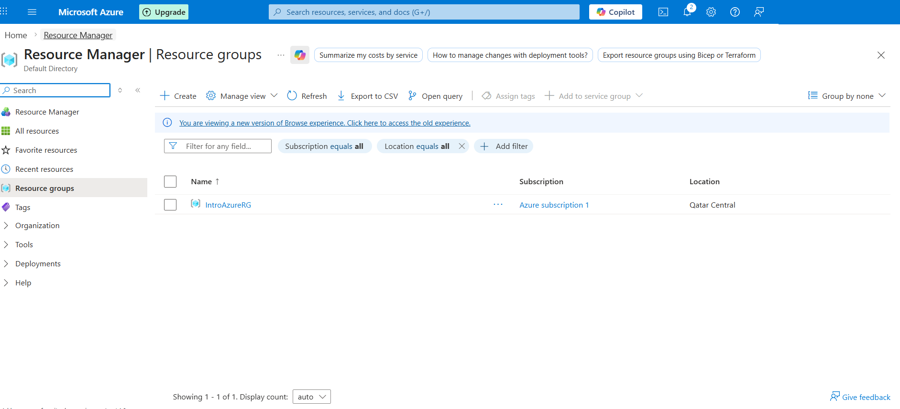
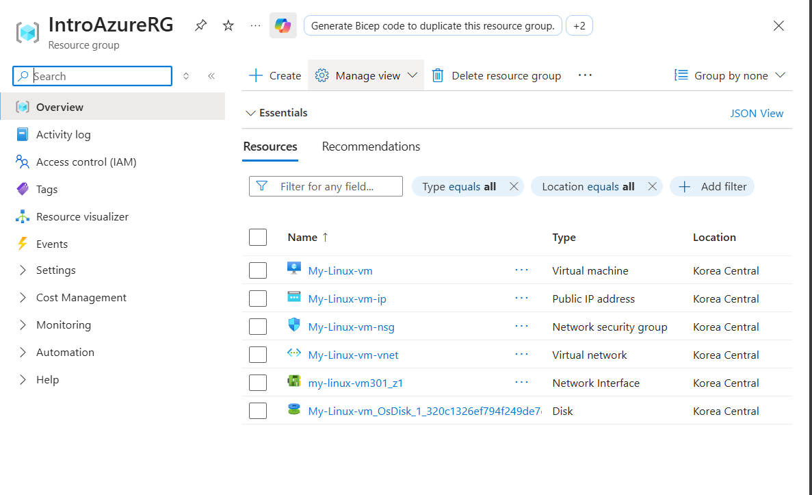
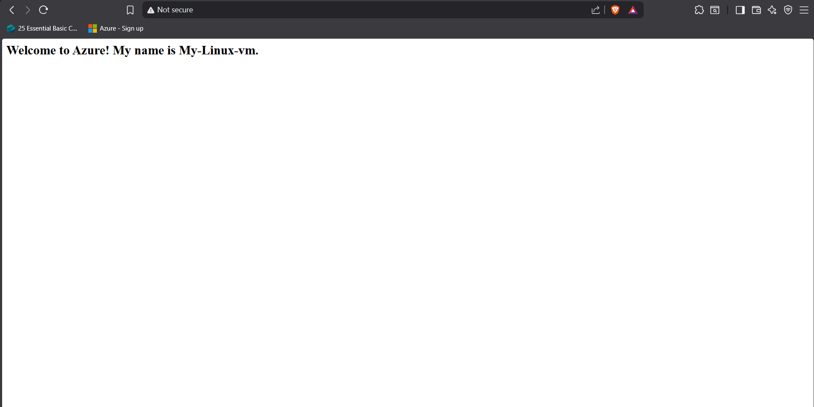

# Azure Fundamentals: Compute & Networking Lab (AZ-900)

## 🎯 Objective
To demonstrate proficiency in deploying and securing cloud infrastructure using Microsoft Azure's Core Architectural components.

## 🛠️ Infrastructure Deployed
* **Resource Group:** Logical container for lifecycle management.
* **Linux VM (Ubuntu):** IaaS compute instance for hosting services.
* **Virtual Network (VNet):** Configured subnets and IP addressing.
* **NGINX Web Server:** Installed via terminal to handle HTTP requests.

## 🛡️ Security Configuration (NSG)
I implemented a **Network Security Group (NSG)** to act as a stateful firewall with the following rules:
* **Inbound Rule (Port 22):** Allowed SSH for remote administrative access.
* **Inbound Rule (Port 80):** Allowed HTTP traffic to serve web content to the public internet.

## 🧠 Key Takeaway
This exercise solidified my understanding of **Inbound Security Rules** and how to bridge the gap between a private virtual network and the public internet.

## Screenshots showing my Azure Resource group, Resources and the NGINX web server

### Resource Group

### Resources

### NGINX website

